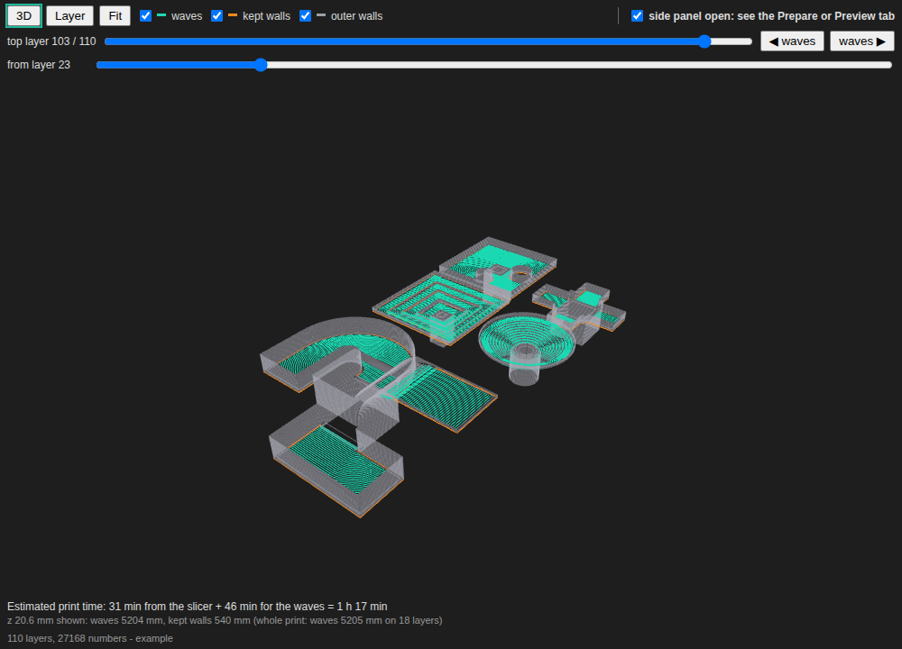
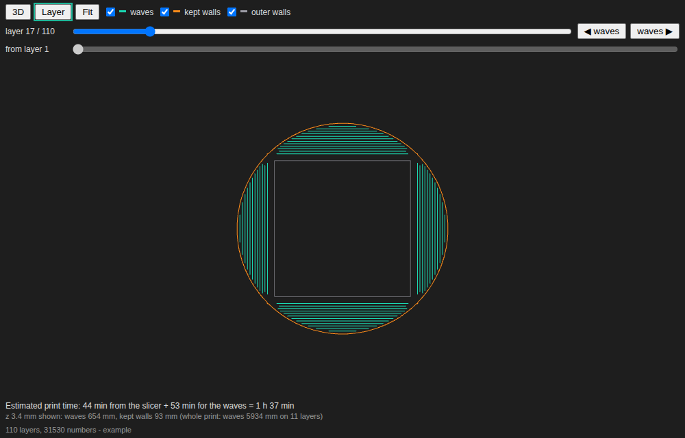
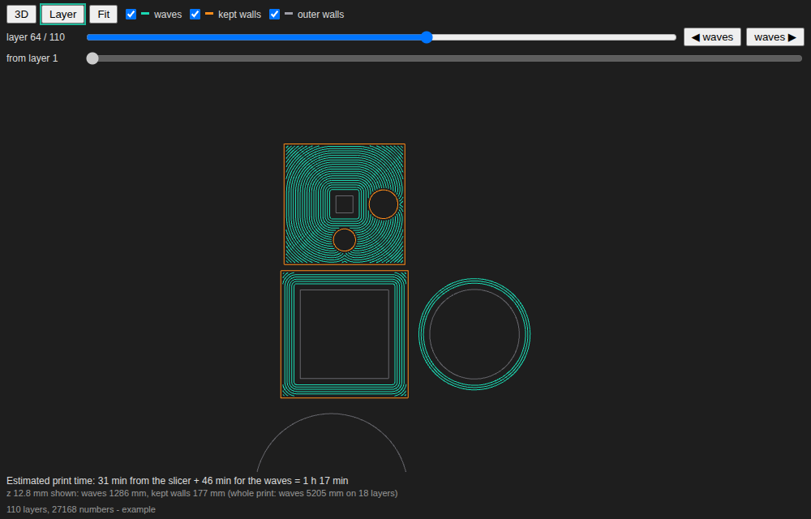
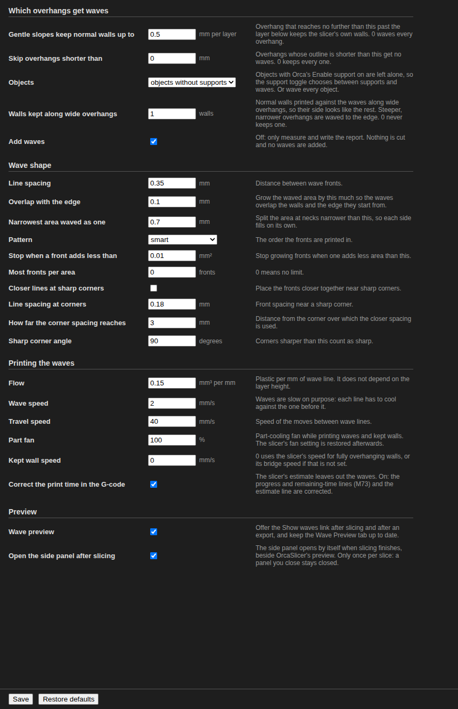

# Wave Overhangs for OrcaSlicer

Print overhangs **without supports**. This plugin for [OrcaSlicer](https://github.com/OrcaSlicer/OrcaSlicer)
prints each overhang as **waves**: lines grown out from the supported edge, front after front, each one
laid against the one before it. The slicer's bridge on the layer above then closes the top.



*The plugin's own preview of a test plate: stepped, sloped and holed overhangs, printed as waves.*

The wave generator is a port of the [OrcaSlicer-WaveOverhangs](https://github.com/dennisklappe/OrcaSlicer-WaveOverhangs)
fork, so you do not need a separate build of OrcaSlicer: install one file in the stock program.

> **Status: experimental.** Tested on a Klipper printer with PLA: single objects, several objects and
> copies on one plate, sloped and stepped overhangs, overhangs with holes, a wipe tower and printing one
> object at a time. Bambu printers are untested. Print a small test model first and watch it.

**Contents:** [Quick start](#quick-start) · [User guide](#user-guide) · [Settings](#settings-reference) ·
[The report](#the-report) · [Troubleshooting](#troubleshooting) · [Known limits](#known-limits) ·
[How it works](#how-it-works) · [Security](#security) · [Credits and license](#credits-and-license)

## Quick start

1. **Install:** in OrcaSlicer open **Plugins** from the main menu, use *More plugin install options* →
   **Install local plugin**, pick `wave_overhangs_plugin.py`, and switch the plugin on. (The first load needs internet: OrcaSlicer installs
   the plugin's two Python packages.)
2. **Select it:** process settings → **Advanced** mode → **Others** → **Slicing Pipeline Plugin** → add
   **Wave Overhangs**. Save the preset.
3. **Several objects or copies?** Turn on **Exclude objects** (Others → G-code output).
4. **Slice.** A notification says how many layers get waves, and the preview panel opens beside the 3D
   view.
5. **Export.** The waves are added to the G-code file, and the time estimate in it is corrected.

## User guide

### 1. Install the plugin

Download `wave_overhangs_plugin.py` from a [release](../../releases) (see [Security](#security) for how
to check it). In OrcaSlicer open **Plugins** from the main menu, use *More plugin install options* →
**Install local plugin** and select the file. Then switch **Wave Overhangs** on in the list.

You need **OrcaSlicer 2.5 or later** (the first release with the Python plugin system) and an internet
connection the first time: OrcaSlicer installs `pyclipper` and `numpy` for the plugin.

Wave Overhangs adds three things to the Plugins dialog (expand it to see them):

- the **slicing pipeline plugin** itself, with its settings;
- **Show Wave Preview**, an action (▶) that opens the preview panel whenever you want it;
- **Wave Preview**, a tab next to Prepare and Preview.

### 2. Turn it on for your prints

Waves are added by the *process* you slice with. Switch the process settings to **Advanced** mode, open
**Others**, find **Slicing Pipeline Plugin** and add **Wave Overhangs**. Save the process preset so it
stays selected.

**Which objects get waves?** Every object whose **Enable support** is off. Turn OrcaSlicer's supports on
for an object and the plugin leaves that object alone, so the support switch chooses between supports and
waves for each object. To wave every object whatever its support setting, set `apply_to` to `all`.

**Several objects or copies on the plate?** Turn on **Exclude objects** or **Label objects** (Others →
G-code output). The plugin uses the labels in the G-code to tell the copies apart and put each one's
waves in the right place. Without labels it can only handle a plate with a single object, and it says so.

### 3. Slice

Slice as usual. When slicing finishes:

- a **notification** says how many layers got waves and roughly how long they take, for example
  *"Wave Overhangs: 18 wave layers, about 46 min."* It has a **Show waves** link and stays for five
  minutes;
- the **preview panel** opens beside the 3D view (this is the `open_panel` setting, on by default).

The panel shows the **waves** (teal), the **kept walls** (orange) and the **outline of every layer**
(grey), placed where they will print. The slicer's own preview does not show the waves, which is why the
plugin has its own.

> **After you reinstall or update the plugin**, OrcaSlicer may reuse its earlier slice, which the new
> plugin never saw. The export then says *"no waves added, because OrcaSlicer reused an earlier slice"*.
> Fix: in the process settings remove Wave Overhangs from **Slicing Pipeline Plugin**, slice, add it back,
> slice again and export.

### 4. Read the preview



*Layer view of a 45 mm disc over a 32 mm column: the waves grow from the column out to the disc's edge,
and a normal wall (orange) closes the edge.*



*A busier layer: waves fill a plate around two holes, and a stepped square and a cone get waves too.*

| Control | What it does |
|---|---|
| **3D** / **Layer** | Orbit the model, or look straight down at one layer. |
| Mouse | Drag to orbit, right-drag (or Shift-drag) to pan, wheel to zoom, double-click or **Fit** to frame the waves. |
| **top layer** slider | The highest layer shown (Up / Down arrow keys step one layer). |
| **from layer** slider | The lowest layer shown, so you can look at a few layers only. |
| **◀ waves / waves ▶** | Jump to the previous or next layer that has waves. |
| waves, kept walls, outer walls | Show or hide each kind. |
| Time line | *"Estimated print time: 31 min from the slicer + 46 min for the waves = 1 h 17 min."* Before an export it says how long the waves add; the slicer's own part comes with the export. |

Two ways to see it, with the same content:

- the **side panel** sits beside OrcaSlicer's own preview in the **Prepare** and **Preview** tabs, so you
  can compare. It opens by itself after slicing. If you close it, open it again from the **Show waves**
  link, from the ▶ next to **Show Wave Preview** in the Plugins dialog, or from the tab (below);
- the **Wave Preview tab**, next to Prepare and Preview, always there and using the whole window. It
  updates itself after every slice and export. Its **show side panel** checkbox (right of the toolbar)
  opens the side panel and turns bold when it is open: "side panel open: see the Prepare or Preview tab".
  Unticking it closes the panel. OrcaSlicer does not let a plugin switch tabs, so click Prepare or Preview
  yourself to see the panel.

### 5. Export and print

Export the G-code as usual. The plugin adds the waves to the file and puts the slicer's own settings back
afterwards (retraction, fan, feed rate). A second notification shows the time the waves add. The preview
refreshes from the exported file itself, so it now shows exactly what will print.

- Waves print **slowly** (2 mm/s) with the part fan at 100 %: each line has to cool against the one
  before it. A ~45 mm disc over a 32 mm column adds about 16 minutes on its one overhang layer.
- **Print time:** OrcaSlicer's own estimate, and the time in the exported file's *name*, leave the waves
  out. The plugin corrects the numbers *inside* the file (the `M73` progress lines a printer's display
  uses, and the "estimated printing time" line) and shows the total in its preview. The file name keeps
  the slicer's time, because OrcaSlicer names the file before the plugin runs.
- The first lines of the file are a [report](#the-report) of what was done.

To look at the finished file in OrcaSlicer's own viewer, open it in a **second** OrcaSlicer (the editor has
no "Open G-code" item, and opening a G-code file in the window you are slicing in closes your project):
in Windows Explorer right-click the file → **Open with** → **OrcaSlicer**, or **File → New Window** and
drag the file in. If New Window is greyed out, turn off **Allow only one OrcaSlicer instance** in
Preferences.

### 6. Change the settings

Open the **Plugins** dialog, expand **Wave Overhangs** and open the settings of the pipeline plugin (or use
**Others → Plugin Configuration** in the process settings).



The page lists every setting with a unit and an explanation, and shows the default for any you have not
changed. A changed setting gets a dot until you press **Save**; then save the process preset to keep the
values. **Restore defaults** puts everything back. The most useful ones:

- **Gentle slopes keep normal walls up to** (`min_overhang_mm`, 0.5): slopes that grow less than this per
  layer are left to the slicer. `0` waves every overhang.
- **Walls kept along wide overhangs** (`outer_walls`, 1): normal walls printed against the waves, so the
  side looks like the rest of the print. `0` runs the waves to the edge.
- **Open the side panel after slicing** (`open_panel`, on).
- **Correct the print time in the G-code** (`adjust_print_time`, on).

## Settings reference

All settings, with their defaults. Distances are in mm. (The settings page shows the same list.)

### Which overhangs get waves

| Setting | Default | What it does |
|---|---|---|
| `min_overhang_mm` | `0.5` | Overhang that reaches no further than this past the layer below keeps the slicer's normal walls. Meant for gentle slopes: at 0.2 mm layers, 0.5 mm per layer is about 68° from vertical. Where such a slope joins an overhang that reaches further, the strip next to it is still waved, because the waves need it as their anchor. `0` waves every overhang, as the fork does. |
| `min_length_mm` | `0` | Skip overhangs whose outline is shorter than this. |
| `outer_walls` | `1` | Normal walls kept along the edge of wide overhangs, printed right after the waves, innermost first; the waves fill the area inside them. Chosen automatically per overhang: a wall is kept only where the overhang reaches past it plus two wave lines (about 1.1 mm per layer with the defaults, roughly 80° from vertical at 0.2 mm layers), so the waves inside can carry it. Steeper, narrower overhangs are waved right to the edge, and where one joins a wide overhang only the wide part gets a wall. `0` never keeps a wall. At most the process's wall count. |
| `apply_to` | `unsupported` | `unsupported`: objects with OrcaSlicer's **Enable support** on are left alone. `all`: wave every object. |
| `enabled` | `1` | `0` only measures and writes the report. Nothing is cut and no waves are added. |

### Wave shape

| Setting | Default | What it does |
|---|---|---|
| `line_spacing_mm` | `0.35` | Distance between wave fronts. |
| `perimeter_overlap_mm` | `0.1` | Grow the waved area by this much, so the waves overlap the walls and the edge they start from. |
| `minimum_wave_width_mm` | `0.7` | Split the wave area at necks narrower than this, so each side fills on its own. |
| `pattern` | `smart` | Order of the fronts: `smart`, `monotonic` or `zigzag`. |
| `min_new_area_mm2` | `0.01` | Stop growing fronts when one adds less area than this. |
| `max_iterations` | `0` | Maximum number of fronts per area (`0` = no limit). |
| `corner_taper_enable` | `0` | `1` places fronts closer together near sharp corners. |
| `line_spacing_corner_mm` | `0.18` | Front spacing at those corners. |
| `corner_taper_distance_mm` | `3.0` | How far from the corner the closer spacing reaches. |
| `corner_angle_threshold` | `90` | Corners sharper than this angle (degrees) count as sharp. |

### Printing the waves

| Setting | Default | What it does |
|---|---|---|
| `flow_mm3_per_mm` | `0.15` | Plastic per mm of wave line. It does not depend on the layer height. |
| `print_speed_mm_s` | `2` | Wave printing speed. Slow on purpose. |
| `travel_speed_mm_s` | `40` | Travel speed between wave lines. |
| `fan_speed_percent` | `100` | Part-cooling fan while printing waves and kept walls. The slicer's fan setting is restored afterwards. |
| `wall_speed_mm_s` | `0` | Speed of the kept walls. `0` uses the slicer's speed for fully overhanging walls (Speed → Overhang speed, the 75–100 % value), or its bridge speed if that is not set. |
| `adjust_print_time` | `1` | Correct the print-time information in the exported G-code (the `M73` lines and the estimate line). `0` leaves the slicer's numbers as they are. |

The rest comes from your printer and filament profiles: nozzle diameter (the wave line width), retraction
length (capped at 2 mm), filament diameter, relative or absolute E, wall and bridge line widths, and
resolution.

### Preview

| Setting | Default | What it does |
|---|---|---|
| `preview` | `1` | Offer the **Show waves** link and keep the **Wave Preview** tab up to date. `0` turns the preview off. |
| `open_panel` | `1` | Open the side panel by itself when slicing finishes, once per slice: a panel you close stays closed, and the export that follows does not reopen it. |

## The report

**Notifications.** After slicing, one line says how many layers got waves and roughly how long. After an
export, another gives the time the waves add. Problems (an object that could not be placed, a reused
slice) show as a warning that stays until you close it.

**Log.** Each slice and export adds a line to `wave_overhangs_log.jsonl`, next to the installed plugin
file, with the settings, counts and report. Attach it to bug reports (after removing anything private).

**In the G-code.** The first lines of the exported file, for a plate with several objects:

```
; WAVE_OVERHANGS version 0.12.0; state hand-over: module global kept, capability instance kept
; WAVE_OVERHANGS OverhangWaveTest.stl (#0) generated at posSlice: 258 wave path(s) in 17 region(s) on 12 layer(s), 4210.381 mm; slices cut on 12 layer(s)
; WAVE_OVERHANGS G-code: standard tags, 110 layers, object labels: EXCLUDE_OBJECT_START/END, 4 instance(s)
; WAVE_OVERHANGS OverhangWaveTest.stl_id_0_copy_0: OverhangWaveTest.stl (#0), offset X 134.85 Y 186.214 mm (deviation from it: 90th percentile 0 mm, worst layer 0 mm; size mismatch 0 mm; 73 of 73 layers compared), waves on 12 layer(s)
; WAVE_OVERHANGS injected 25 wave block(s): 9015.531 mm of wave line, 562.233 mm of filament, about 77.761 min
; WAVE_OVERHANGS print time: slicer 31m 0s + waves 1h 17m 40s = 1h 48m 40s; 112 M73 line(s) and the estimate line corrected
```

- **generated** (one per object): how many waves were computed and on how many layers.
- **G-code**: how many object copies were found, and from which labels.
- **One per copy**: which object it matched and where it sits on the plate. The deviation and size
  mismatch should be close to 0.
- **injected**: the total wave line, filament and added time; then the corrected print time.

Each layer's waves sit between `; WAVE_OVERHANGS_START` and `; WAVE_OVERHANGS_END` and are typed
`Overhang wall`.

## Troubleshooting

| You see | Meaning and fix |
|---|---|
| No waves, and a warning *"OrcaSlicer reused an earlier slice"* (report: `nothing captured at slice time`) | The plugin never saw the slice: it was not selected, or OrcaSlicer reused an earlier slice (it does after you reinstall or update the plugin). Remove Wave Overhangs from **Slicing Pipeline Plugin**, slice, add it back, slice again, export. |
| `WARNING: ... the slices were not cut` | OrcaSlicer reused slicing from before the plugin was selected, so the slicer's own walls are still in the overhang. Make it slice again from the start (change a slicing setting and slice). |
| *"With several objects, turn on Exclude objects or Label objects"* | Turn on **Exclude objects** or **Label objects** (Others → G-code output). |
| `no captured object matches (...)` | The plugin could not place that copy, so it got no waves. Slice again; if it persists, report it with the G-code. |
| `has waves but was not placed` | That object is not in this G-code, for example because it is on another plate. |
| `already processed, left untouched` | The file already had waves. The plugin never adds them twice. |
| `Orca supports are on, left alone` | That object has **Enable support** on. Turn supports off for it, or set `apply_to` to `all`. |
| A setting is missing from the Plugins dialog | Use 0.11.0 or later: it has a settings page that lists every setting. |
| The **Show waves** link is gone | The notification stays for five minutes. Use the tab's **show side panel** checkbox, or the ▶ next to **Show Wave Preview** in the Plugins dialog. |
| The time in the file name is too short | OrcaSlicer builds the name before the plugin runs. The numbers inside the file are corrected. |

## Known limits

- **OrcaSlicer's own preview and print-time estimate** (non-Bambu printers) do not include the waves: the
  plugin adds them to the G-code file at export. The plugin's preview and the corrected G-code cover
  this. A [proposal to OrcaSlicer](docs/upstream-proposal-preview-postprocess.md) would fix it at the
  source.
- **Plugins cannot add toolpaths** to OrcaSlicer yet, so the waves are added to the G-code text. As a
  result waves print at the end of each object's part of the layer (not before that island's walls, as in
  the fork), and the slicer's supports do not know about them.
- **Every overhang that is not a gentle slope gets waves**, including ones the slicer could bridge. The
  fork can leave bridgeable overhangs as bridges; plugins cannot call the slicer's bridge detection.
- **Not ported from the fork:** floor layers, Hilbert-curve floors, a separate wave temperature, minimum
  wave or layer times, progressive spacing, seam mode, end-of-wave retraction and the second fan. The
  slicer's bridge on the layer above is the floor.
- **The top layer** of an object gets no waves.
- **Two filaments on one layer of one object** (painted colours): its waves use the filament that was
  active last on that layer.
- **The preview** draws one-pixel lines and only the outline of each layer; it checks where the waves go,
  it does not replace OrcaSlicer's preview.
- **Bambu printers** are untested.

## How it works

1. **While slicing**, the plugin works out the waves for every overhang and cuts the overhang area out of
   that layer, so OrcaSlicer prints nothing there. On the layer above, OrcaSlicer sees air underneath and
   prints a bridge, which becomes the floor on top of the waves.
2. **When the G-code is exported**, the plugin adds the waves to each layer at slow speed with full fan,
   then (on wide overhangs) one normal wall along the edge, laid against the waves; it restores the
   slicer's retraction, fan, feed rate and extrusion mode, and corrects the print time.

The design notes are in [`CLAUDE.md`](CLAUDE.md) and the build log in
[`docs/development-notes.md`](docs/development-notes.md).

## Security

The plugin runs inside OrcaSlicer, so it is worth knowing what it does: it reads and rewrites the exported
G-code, writes one log file next to itself and shows OrcaSlicer windows; it makes **no network
connections**, starts **no other programs** and loads nothing from the internet. Its two dependencies are
pinned (`pyclipper==1.4.0`, `numpy>=2.0,<3`). Each release lists the SHA-256 of the plugin file so you can
check your copy. Details, and how to report a vulnerability, are in [SECURITY.md](SECURITY.md).

## Credits and license

This plugin stands on other people's work:

- **Wave overhangs algorithm:** Janis A. Andersons (andersonsjanis).
  Research: *Wave-Inspired Path-Planning Strategy for Support-Free Horizontal Overhangs in FDM* (2026),
  [doi:10.2139/ssrn.6640458](https://doi.org/10.2139/ssrn.6640458), with its dataset
  [doi:10.17632/xhw8xkjyc2.1](https://data.mendeley.com/datasets/xhw8xkjyc2/1).
- **Arc-overhang algorithm** (the predecessor it builds on) and the **PrusaSlicer integration:**
  Steven McCulloch ([stmcculloch/arc-overhang](https://github.com/stmcculloch/arc-overhang),
  [stmcculloch/PrusaSlicer-WaveOverhangs](https://github.com/stmcculloch/PrusaSlicer-WaveOverhangs)).
- **Port to OrcaSlicer:** Dennis Klappe
  ([dennisklappe/OrcaSlicer-WaveOverhangs](https://github.com/dennisklappe/OrcaSlicer-WaveOverhangs)).
  This plugin is a Python port of that fork's generator (`WaveOverhangs.cpp`), keeping its structure and
  names so the two can be compared.
- **OrcaSlicer** ([OrcaSlicer/OrcaSlicer](https://github.com/OrcaSlicer/OrcaSlicer), AGPL-3.0): the plugin
  system this runs on, and the sample plugins whose patterns it follows. This project is independent and
  is **not made or endorsed by the OrcaSlicer project**; "OrcaSlicer" is the name of that project.
- **Support Fins** by gittrahan ([MIT](https://github.com/gittrahan/support-fins)): another OrcaSlicer plugin whose
  notification, settings-page and lifecycle handling showed how to do those things in a plugin.
- **Libraries**, installed by OrcaSlicer from PyPI and not included here:
  [pyclipper](https://github.com/fonttools/pyclipper) (MIT), a wrapper for Angus Johnson's Clipper library,
  and [NumPy](https://numpy.org) (BSD-3-Clause).

**License:** [GNU Affero General Public License v3.0 or later](LICENSE) (`AGPL-3.0-or-later`), like the code
it is ported from. You may use, share and change it under those terms; a changed version must stay under
the same licence and make its source available. Copyright (C) 2026 WaveOverHangsPlugin contributors.
There is no warranty: you print at your own risk.

See also: [CONTRIBUTING.md](CONTRIBUTING.md) · [CHANGELOG.md](CHANGELOG.md) · [SECURITY.md](SECURITY.md)
